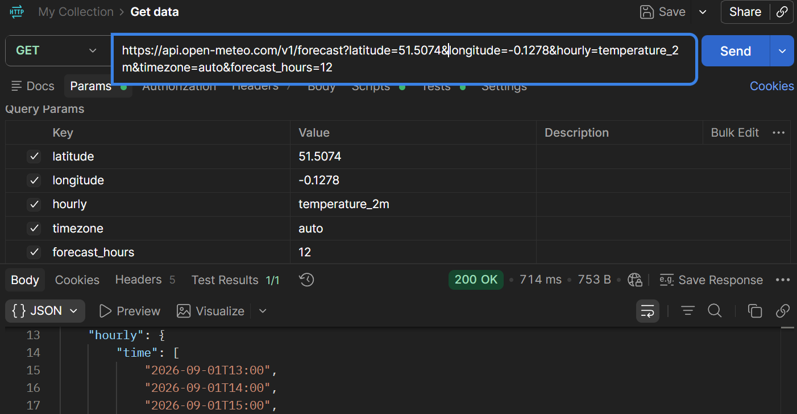
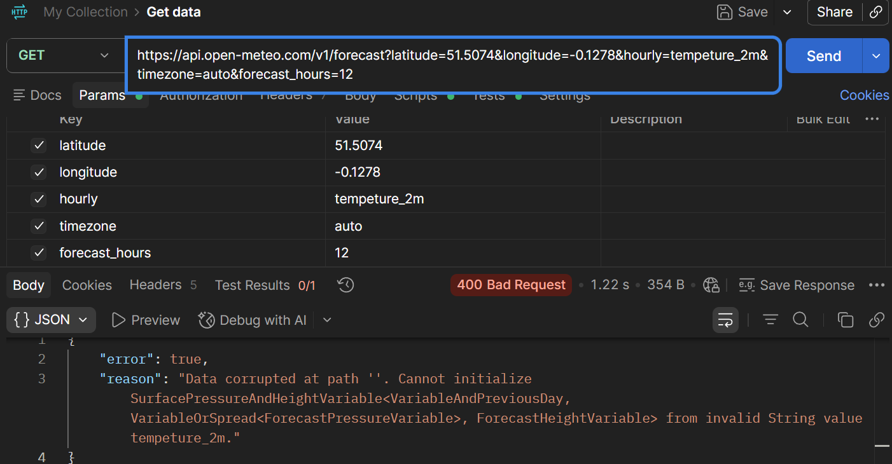
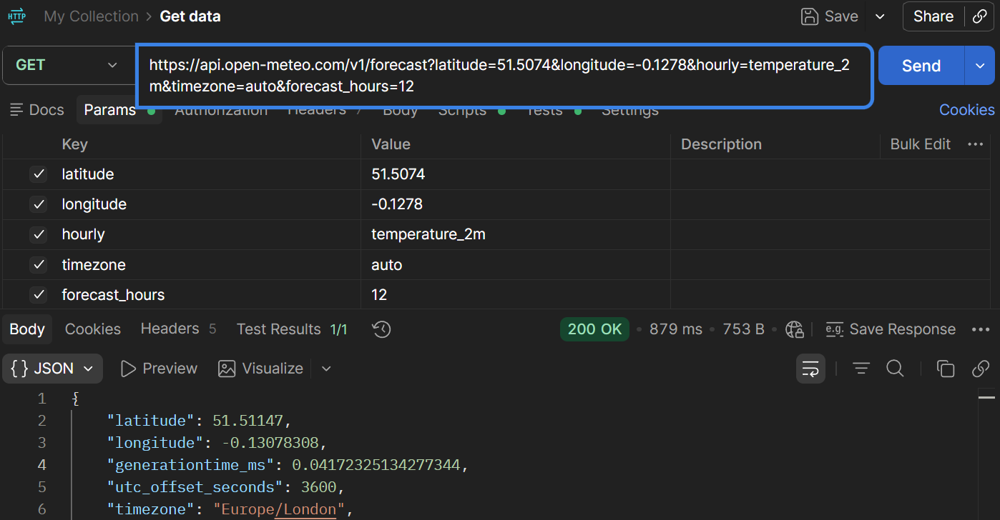

# Get and Verify an Hourly Weather Forecast with Postman

In this tutorial, you’ll use Postman to request hourly temperature data from the Open-Meteo API and inspect the JSON response. You’ll also verify that the returned data matches the request you sent.

You’ll also go beyond the happy path. After building the request, you’ll learn how to:

- interpret the response
- verify the data it contains
- introduce an error deliberately
- use the API’s error message to diagnose the request
- correct and verify the request

Let’s start by creating the request in Postman.

## What You’ll Need

To follow this tutorial, you’ll need:

- **Postman** — the web version is sufficient.
- An **internet connection**.
- Basic familiarity with **APIs, HTTP `GET` requests, URLs, and JSON**.

You **don’t** need:

- Programming experience
- Python or JavaScript knowledge
- Advanced Postman experience
- An Open-Meteo API key

## 1. Create the Request

Create an HTTP `GET` request to the Open-Meteo API in the Postman workspace:

1. Open the Postman workspace by visiting https://go.postman.co/workspaces and logging in with your Postman account credentials.
2. Create a new HTTP request or use an existing one in the Postman workspace UI.
3. Select the `GET` method in the dropdown list next to the URL text box.
4. Enter the Open-Meteo API endpoint in the URL text box: `https://api.open-meteo.com/v1/forecast`
5. Leave the Params table below the URL text box empty for now.
6. Click the blue **Send** button next to the URL text box.
7. Observe the response returned by Open-Meteo in the Response pane below the Params table.

## 2. Add the Location

The initial request returned a `200 OK` status code but contained no weather-related data.

To request weather information for a particular location, provide the location’s coordinates as query parameters in the HTTP `GET` request:

1. Open the **Params** tab/table beneath the URL text box in the Postman workspace.
2. Add a parameter with the key `latitude` and the value `51.5074`.
3. Add another parameter with the key `longitude` and the value `0.1278`.
4. Click the **Send** button next to the URL text box.
5. Observe the JSON response, which now contains location-related metadata, including latitude and longitude.

**Note:** The coordinates used in this tutorial correspond to London, UK.

When you add parameters through the Params table, Postman adds them to the request URL as query parameters.

## 3. Request Hourly Temperature Data

Next, request hourly temperature data by adding another parameter to the HTTP request:

1. Open the **Params** tab under the URL text box in the Postman workspace.
2. Add a parameter with the key `hourly` and the value `temperature_2m` to the Params table.
3. Click the **Send** button next to the URL text box.
4. Inspect the JSON response, which now contains the requested hourly temperature data:
    - An `hourly` object containing a `time` array and its corresponding `temperature_2m` values.
    - An `hourly_units` object showing the unit for the temperature values.

**Note:** In the newly added parameter:

- `hourly` specifies the hourly weather variables requested from the API.
- `temperature_2m` requests temperature at 2 metres above the surface.

## 4. Set the Timezone

Next, set the forecast’s timezone by adding another parameter to the HTTP request:

1. Open the **Params** tab under the URL text box in the Postman workspace.
2. Add a parameter with the key `timezone` and the value `auto` to the Params table.
3. Click the **Send** button next to the URL text box.
4. Inspect the JSON response. It now includes timezone-related metadata, particularly:
    - `utc_offset_seconds`: the local timezone’s offset from UTC, expressed in seconds.
    - `timezone`: the local timezone.
    - `timezone_abbreviation`: the abbreviated name of the local timezone.

**Note:** `timezone=auto` tells Open-Meteo to determine the timezone from the requested coordinates. For the coordinates used in this tutorial, the response identifies the timezone as `Europe/London`.

## 5. Limit the Forecast to 12 Hours

Finally, limit the hourly forecast to 12 timesteps by adding another parameter to the HTTP request:

1. Open the **Params** tab under the URL text box in the Postman workspace.
2. Add a parameter with the key `forecast_hours` and the value `12` to the Params table.
3. Click the **Send** button next to the URL text box.
4. Inspect the JSON response. The `time` and `temperature_2m` arrays now each contain 12 values.

**Note:** The parameter `forecast_hours=12` limits the hourly forecast returned by the API to 12 timesteps. The first timestep depends on when the request is made.



## 6. Read the JSON Response

Open-Meteo’s response is formatted as JSON (JavaScript Object Notation). JSON organizes the response data into named fields and objects.

The core forecast data is packaged inside these fields:

- `hourly_units` — shows the units associated with the hourly data, including the temperature unit.
- `hourly` — contains the requested hourly forecast data for the specified number of timesteps.

Within the `hourly` field:

- `time` array — contains the hourly timestamps.
- `temperature_2m` array — contains the corresponding temperature values.

**Note:** Each position in the `time` array corresponds to the value at the same position in the `temperature_2m` array.

For example, conceptually:

```
time[0] ↔ temperature_2m[0]
time[1] ↔ temperature_2m[1]
time[2] ↔ temperature_2m[2]
```

## 7. Verify the Response

After inspecting the JSON response, verify that it matches the request.

In the response pane, check these five points:

1. **Status:** The response returned `200 OK`.
2. **Requested data:** The response contains the `hourly` object with the requested `temperature_2m` data.
3. **Timestamp data:** The `time` array contains 12 timestamps.
4. **Temperature data:** The `temperature_2m` array contains 12 temperature values.
5. **Correspondence:** Each timestamp has a corresponding temperature value at the same array position. The conceptual relationship is:
    
    ```
    time[0] ↔ temperature_2m[0]
    time[1] ↔ temperature_2m[1]
    ...
    time[11] ↔ temperature_2m[11]
    ```

## 8. Break the Request on Purpose

The request now works as expected. To practice troubleshooting, deliberately introduce a known error and observe how the API responds:

1. Open the **Params** tab under the URL text box in the Postman workspace.
2. Locate the `hourly` parameter in the Params table.
3. Change its value from `temperature_2m` to `tempeture_2m`.
4. Click the **Send** button next to the URL text box.
5. Observe the HTTP response in the **Response** pane. You will see that:
    - The response status changes from `200 OK` to `400 Bad Request`.
    - The response also contains an error message explaining that the requested hourly variable is invalid.



## 9. Diagnose the Error

Use the API’s error response as **diagnostic evidence**, rather than randomly changing request parameters to fix an error.

The error response contains two pieces of information:

- **The HTTP status:** `400 Bad Request` indicates that the server rejected the request because it was invalid.
- **The API’s error message:** It gives the specific reason for the rejection—the value supplied for the requested hourly variable is invalid.

**Note:** The status code indicates that the request failed at the request level. The API’s error message helps identify what is wrong with the request.

Comparing the error response with the request shows why it failed:

```
Request:
...&hourly=tempeture_2m&...

Error:
invalid hourly variable
```

The comparison indicates that the value of the `hourly` parameter is invalid. In our case, this was caused by a deliberately introduced typo.

## 10. Fix and Verify the Request

After diagnosing the error, fix it:

1. Open the **Params** tab under the URL text box in the Postman workspace.
2. Locate the `hourly` parameter in the Params table.
3. Change its value from `tempeture_2m` to `temperature_2m`.
4. Click the **Send** button next to the URL text box.
5. Observe the HTTP response in the **Response** pane. Confirm that the response status is `200 OK`.
6. Inspect the `hourly` object inside the JSON response and verify that:
    - The `time` array contains 12 timestamps
    - The `temperature_2m` array contains 12 temperature values
    - The two arrays correspond position by position



**Note:** Fixing the request is **not** the final step. Re-send the request and verify the response using the same checks as before.

[Inspect the complete 12-hour forecast response (JSON)](assets/OM_Experiment7_Output.json)

## What You Learned

In this tutorial, you learned how to:

1. Build an HTTP `GET` request in Postman using query parameters.
2. Request hourly data from a public REST API.
3. Read the important parts of a JSON response.
4. Verify that the response matches the request.
5. Use an API’s status code and error message to diagnose a failed request.
6. Correct the request and verify the result again.

This workflow provides a practical foundation for working with other REST APIs:

> **Construct → inspect → verify → diagnose → fix → verify again**
> 

## Next Steps

Next, you can:

1. **Try changing the existing request**
    
    Modify the location coordinates or request another supported hourly variable.
    
    Experimenting with the existing request reinforces the workflow without introducing a new tool.
    
2. **Explore the API documentation**
    
    Explore the Open-Meteo documentation to discover other parameters and available forecast variables.
    
    This reinforces a professional habit: read the API documentation rather than guessing at parameters.
    
3. **Apply the same workflow to another API**
    
    Apply the same basic process to a different public API.
    

## References

- Open-Meteo Forecast API documentation: https://open-meteo.com/en/docs
- Postman request parameters documentation: https://learning.postman.com/docs/use/send-requests/create-requests/parameters
