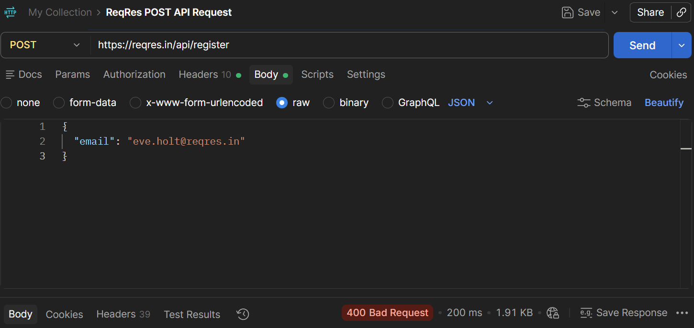
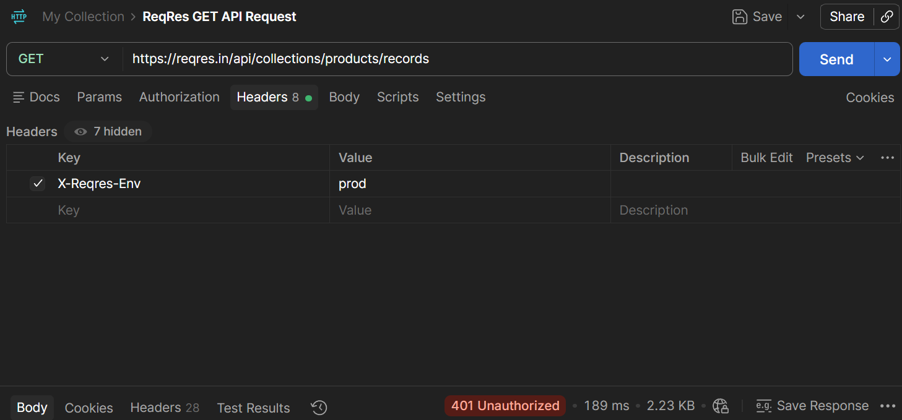
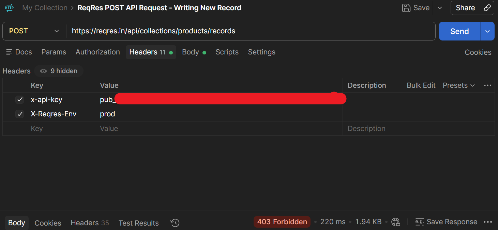
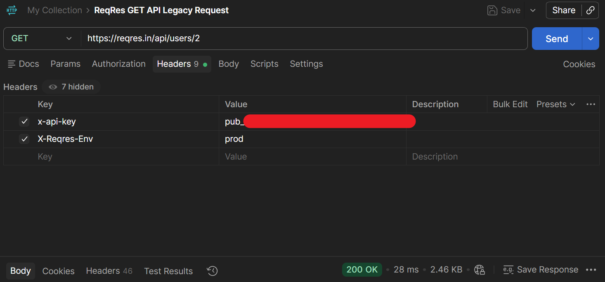
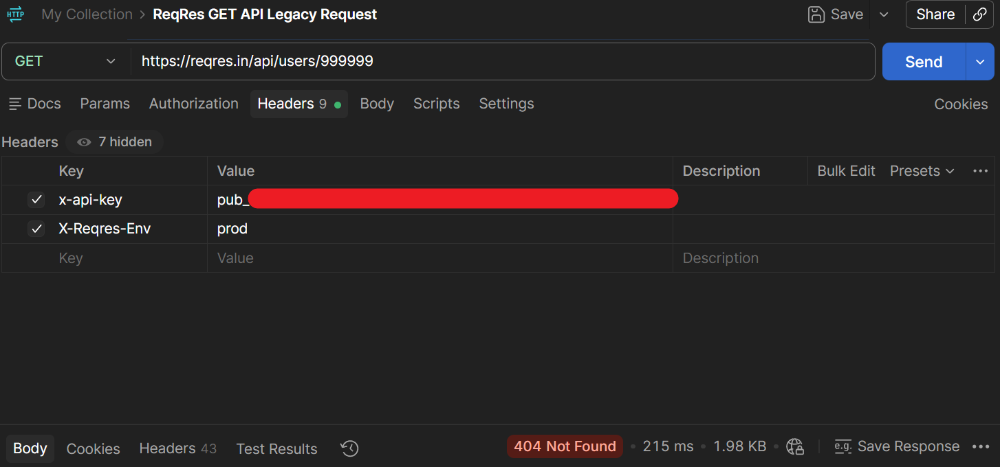

# Why Did My API Request Fail? A Diagnostic Workflow for 400, 401, 403, and 404 Responses

## An Error Code Is a Starting Point

Suppose you send an API request and the server returns a 4xx response. You know the request wasn’t successfully fulfilled. But the status code alone doesn’t indicate which part of the request needs attention.

The status code provides a direction for investigation, but it does not identify the root cause by itself. For example, the four status codes point toward the following investigation areas:

- 400 → investigate the request
- 401 → investigate authentication
- 403 → investigate authorization or access
- 404 → investigate the requested resource

Use an evidence-based approach to examine the four common 4xx codes:

1. Start with a working request
2. Change one thing
3. Observe the failure
4. Use the response as evidence

Each case deliberately introduces a single problem, inspects the resulting evidence, corrects the request, and verifies the result.

## Start from a Known-Good Request

A failed request is easier to diagnose when it’s compared with an already working request. Capture a known-good request and its successful response before deliberately changing one component of the failed request.

Postman sends requests to the ReqRes API for comparison between successful and deliberately broken requests.

The following GET request to the ReqRes Products collection serves as the verified baseline:

```
GET https://reqres.in/api/collections/products/records
```

The relevant request headers were:

```
x-api-key: <project-scoped public key>
X-Reqres-Env: prod
```

**Note:** The API key is a project-scoped public key with read-only permissions, which is sufficient for this request.

The known-good request returned a `200 OK` status. Its JSON response contained three product records:

```json
{
  "data": [
    {
      "data": {
        "name": "Wireless Headphones",
        "price": 59.99
      }
    }
  ],
  "meta": {
    "total": 3
  }
}
```

This working request provides the following four baseline reference points:

- URL
- method
- relevant headers
- expected response

Apply the **one-change rule:** when deliberately creating a failure, change only one component of the working request at a time. Multiple changes make it harder to identify which change caused the failure.

The evidence-based comparison approach can be represented as:

```
Known-good request
        ↓
Successful response
        ↓
Change one thing
        ↓
Failed request
        ↓
Compare the evidence
```

## What Evidence Should You Inspect?

You now have a working baseline request with a successful response. The next step is to inspect the request and response for diagnostic clues.

**A failed API request leaves clues in both the request sent and the response received.** Besides the status code, inspect the request and response details.

The diagram presents the main request and response components to inspect:

```
             Failed request
                    │
          ┌─────────┴─────────┐
          ↓                   ↓
      What's sent          What's received
          │                   │
      URL / path           Status code
      Parameters           Response body
      Headers
      Body
```

### Six Evidence Sources

The following evidence sources support the failure diagnosis:

| Evidence | What it can reveal |
| --- | --- |
| URL / path | Wrong endpoint or resource |
| Query parameters | Missing or invalid input |
| Headers | Authentication or metadata |
| Request body | Missing or malformed data |
| Status code | Broad failure category |
| Response body | API-specific explanation |

You don’t necessarily need to inspect every source equally. **The status code narrows the investigation**, while **the request and response evidence helps identify the suspected cause**.

The following four investigations use these clues. Each investigation changes one request component and uses the resulting response to guide the diagnosis.

## Diagnose a 400 Bad Request

### Working baseline

Start with the working user registration request:

```
POST https://reqres.in/api/register
```

The request uses the following JSON body:

```json
{
  "email": "eve.holt@reqres.in",
  "password": "pistol"
}
```

The request uses the same project-scoped public key and `X-Reqres-Env: prod` headers as the earlier authenticated known-good baseline:

```
x-api-key: <project-scoped public key>
X-Reqres-Env: prod
```

The request returns a successful response:

```json
{
  "id": 4
}
```

The response confirms that the registration request was accepted.

### Create the controlled failure

Change only one component of the working request: remove the `password` field from the JSON body.

The modified request is:

```json
{
  "email": "eve.holt@reqres.in"
}
```

Keep all other request components unchanged.

The ReqRes API returns a `400 Bad Request` response with this JSON body:

```json
{
  "error": "Missing password"
}
```



The status code indicates that the request was treated as a client error, but it does not identify the specific cause by itself. The response body provides the additional clue.

The evidence can now be connected as follows:

```
Only the `password` field was removed.
        ↓
ReqRes API returned `400 Bad Request`.
        ↓
The response body explicitly says "Missing password".
        ↓
The changed field and the API's explanation point to the same cause.
```

The evidence supports a clear diagnosis for this particular failure: the request was missing the required `password` field.

### Correct and verify

The correction is to restore the `password` field:

```json
{
  "email": "eve.holt@reqres.in",
  "password": "pistol"
}
```

Send the request again. It returns to the previously successful state.

A missing `password` field is one of the many cases that can produce a `400`. The important troubleshooting lessons are:

- **The status code narrowed the investigation.**
- **The controlled change provided a comparison point.**
- **The response body provided evidence that confirmed the suspected cause.**

**Conceptually:** When a `400 Bad Request` response occurs, inspect the request for missing or invalid input. Compare it with a known-good request. Use the response body to identify what the API rejected.

## Diagnose a 401 Unauthorized

### Working baseline

Start with the working request to retrieve the Product records:

```
GET https://reqres.in/api/collections/products/records
```

The request uses these key headers:

```
x-api-key: <project-scoped public key>
X-Reqres-Env: prod
```

The same GET request returns a successful JSON response containing product records.

### Create the controlled failure

Change only one component of the working request: remove the `x-api-key` header. Keep the `X-Reqres-Env` header, URL, and method unchanged.

The ReqRes API returns a `401 Unauthorized` response with this JSON body:

```json
{
  "error": "missing_api_key",
  "message": "The x-api-key header is required for this endpoint."
}
```



The status code indicates that the request lacks valid authentication for this endpoint. The response body provides specific evidence: the `x-api-key` header is required.

[Inspect the full captured 401 response, including its diagnostic hints](assets/ReqRes_Experiment3A_Output.json)

The evidence can now be connected as follows:

```
Only the `x-api-key` header was removed.
        ↓
ReqRes returned a `401 Unauthorized` status code.
        ↓
The response body explicitly states that `x-api-key` is required.
        ↓
The missing authentication credential is the immediate cause of this particular failure.
```

The evidence supports a clear diagnosis for this particular failure: the request was missing the `x-api-key` header required by the endpoint.

### Correct and verify

The correction is to restore the `x-api-key` header:

```
x-api-key: <project-scoped public key>
X-Reqres-Env: prod
```

Send the request again. It returns to the previously successful state with the expected three-record collection.

**Conceptually:** When a `401 Unauthorized` response occurs, inspect the request for missing or invalid authentication information. Compare it with a known-good request. Use the response body to identify why the API could not authenticate the request.

## Diagnose a 403 Forbidden

### Working baseline

Start with the working request to create a new product record:

```
POST https://reqres.in/api/collections/products/records
```

The working POST request’s JSON body is:

```json
{
  "data": {
    "name": "Troubleshooting Test Product",
    "price": 10.99,
    "category": "Testing",
    "in_stock": true
  }
}
```

The request uses a project-scoped manage key (`pro_*`) with write permission:

```
x-api-key: <project-scoped manage key>
X-Reqres-Env: prod
```

The request returns a `201 Created` response, confirming that the API created the new product record.

### Create the controlled failure

Change only one component of the working request: replace the manage key with a valid public key (`pub_*`) with read-only permissions.

```
x-api-key: <project-scoped public key>
X-Reqres-Env: prod
```

Keep all other request components unchanged.

The ReqRes API returns a `403 Forbidden` response with this JSON body:

```json
{
  "error": "insufficient_scope",
  "message": "This API key has read-only permissions."
}
```

The response indicates that the supplied credential does not have sufficient permission for this write operation. 



The response body provides the specific evidence: the API key has read-only permissions.

[Inspect the captured 403 response excerpt, including its diagnostic hints](assets/ReqRes_Experiment4A_Output_Excerpt.json)

The important distinction from the previous `401` case is reflected in the following questions:

- **401** → investigate whether the request is authenticated.
- **403** → investigate whether the supplied credentials permit the requested operation.

The evidence can now be connected as follows:

```
Only the `pro_*` manage key was replaced by the `pub_*` public key.
        ↓
ReqRes returned a `403 Forbidden` status code.
        ↓
The response body states that the key has read-only permissions.
        ↓
The supplied public key lacks the permission required for this operation.
```

The evidence supports a clear diagnosis for this particular failure: the POST request requires a credential with write permission.

The same public key had already been used successfully to retrieve Product records with a GET request. Its failure occurred specifically when that key was used for the write operation.

### Correct and verify

The correction is to restore the manage key (`pro_*`) in the POST request’s headers:

```
x-api-key: <project-scoped manage key>
X-Reqres-Env: prod
```

Send the POST request again. It returns to the previously successful state with the newly created product record.

[View selected fields from the successful product-creation response](assets/ReqRes_Experiment4B_Output_Sanitized.json)

**Conceptually:** When a `403 Forbidden` response occurs, inspect the request’s authentication and permission context. Compare it with a known-good request. Use the response body to determine why the API refused the operation.

## Diagnose a 404 Not Found

### Working baseline

Start with the working request to retrieve a specific user record:

```
GET https://reqres.in/api/users/2
```

The request uses these key headers:

```
x-api-key: <project-scoped public key>
X-Reqres-Env: prod
```

The request returns a `200 OK` response containing the requested user:

```json
{
  "data": {
    "id": 2,
    "email": "janet.weaver@reqres.in"
  }
}
```



The response confirms that the resource with ID `2` exists.

### Create the controlled failure

Change only one component of the working request: change the resource ID in the URL from `2` to `999999`.

The request now becomes:

```
GET https://reqres.in/api/users/999999
```

The rest of the request stays the same.

The ReqRes API returns a `404 Not Found` response with an empty body.



*A response body does not always provide a useful explanation.* In this case, the controlled change and known-good baseline provide the stronger evidence instead.

```
Known resource ID: 2
        ↓
      200 OK

Only resource ID changed: 999999
        ↓
   404 Not Found
```

The evidence points to the requested resource as the source of the failure: the known resource was successfully retrieved, while the changed identifier returned `404`. In this controlled experiment, the requested resource was not found in the API.

### Correct and verify

The correction is to restore the original resource identifier (`2`):

```
GET https://reqres.in/api/users/2
```

Send the GET request again. It returns to the previously successful state with the existing user record.

**Conceptually:** When a `404 Not Found` response occurs, inspect the request’s URL, path, and resource identity. Compare them with a known-good request. Verify that the requested resource is available.

## Compare the Four Investigations

The four experiments produced different failures, but the diagnostic process remained the same.

Their key details are the following:

| Response | Controlled change | Main investigation area | Diagnostic evidence |
| --- | --- | --- | --- |
| 400 | Removed `password` | Request data | Response identified missing password |
| 401 | Removed `x-api-key` | Authentication | Response identified missing API key |
| 403 | Replaced `pro_*` with `pub_*` | Authorization/permissions | Response identified read-only permissions |
| 404 | Changed resource ID `2` → `999999` | Resource identification | Controlled change + known-good baseline |

Across all four experiments, the same core method remained constant. Each experiment made a controlled change and observed the response. The failed request was compared with the known-good baseline, and the evidence guided the correction.

When a single deliberate change produces a failure, that changed component becomes a logical first place to investigate.

### 401 vs 403

Conceptually, 401 and 403 direct the investigation toward different questions:

```
401 → Did the request provide valid authentication?
403 → Did the supplied credentials permit this operation?
```

Evidence quality also varies by case. The `400`, `401`, and `403` response bodies provided explicit clues, while the `404` response body did not. In that case, the controlled change and known-good baseline provided the stronger evidence.

**Use the strongest evidence available rather than relying on a single diagnostic signal.**

The observed pattern can now be turned into a reusable checklist.

## A Compact Troubleshooting Checklist

The four experiments can be distilled into a general troubleshooting checklist. Use the following sequence when an API request fails:

1. **Reproduce the failure:** Confirm that the failure can be reproduced before changing anything.
2. **Compare it with a known-good request:** Find the last working request, or construct a minimal known-good version to use as a reference.
3. **Check the status code:** Use it to narrow where to investigate.
4. **Inspect the relevant request and response evidence:** Check the URL, parameters, headers, request body, response headers, and response body for clues relevant to the failure.
5. **Compare with the API’s documented requirements:** Check what the endpoint expects for the request and what conditions it requires.
6. **Form a working diagnosis:** Use the available evidence to identify the request component or condition most relevant to the failure.
7. **Make one targeted correction:** Change the component or condition most directly related to the suspected cause.
8. **Retry and verify the result:** Confirm that the request now produces the expected response.

**Remember:** Change only one request component at a time while diagnosing a failure. A single change combined with the observed result creates a clearer causal relationship. Changing multiple components at once makes it harder to determine which change caused the result.

The next section defines the scope and boundaries of this guide.

## What This Workflow Does Not Tell You

This guide focuses on four common 4xx responses: 400, 401, 403, and 404. Diagnosis uses a known-good request, the failed request, and the available evidence to identify a suspected cause.

These four codes are not exhaustive. Many other HTTP/API failure situations exist, including the following:

- 405 → Method Not Allowed
- 422 → Unprocessable Content
- 429 → Too Many Requests
- 5xx → Server Error responses

5xx responses require a different class of investigation and are outside the scope of this guide. Other problems, such as network or security failures and deeper server-side or production failures, also require different diagnostic approaches.

The workflow itself is reusable, but the specific evidence and corrective actions depend on the type of failure and the API involved. For example, the four experiments showed the following:

- 400: request-body evidence mattered
- 401: authentication evidence mattered
- 403: permission evidence mattered
- 404: resource identification mattered

**The workflow is general, but the evidence and diagnosis are context-dependent.**

This workflow does **not** eliminate the need to consult API documentation or investigate beyond the request when the evidence indicates that the problem extends further.

The next section brings the article’s main lessons together.

## What You Learned

Troubleshooting becomes more reliable when you treat a failed request as a systematic investigation rather than guesswork.

The general diagnostic lifecycle can be represented as:

```
Known-good request
        ↓
One deliberate change
        ↓
Observed failure
        ↓
Request + response evidence
        ↓
Working diagnosis
        ↓
Targeted correction
        ↓
Verified result
```

The experiments demonstrate the following three key ideas:

- **Signal:** The status code narrows where to investigate.
- **Evidence:** The request, response, and known-good baseline help identify the suspected cause.
- **Verification:** Retrying the corrected request shows whether the correction resolved the failure.

Changing one request component at a time strengthens the comparison between the change and the observed result.
When a response provides a useful explanation, use it as evidence. When it does not, rely more heavily on the controlled comparison and other available request and response details.

The central mental model is simple: **start from what works, change one thing, investigate the evidence, make a targeted correction, and verify the result.**

The final section outlines possible next steps.

## Next Steps

The evidence-based workflow demonstrated here provides a starting point for broader API troubleshooting as the problems become more complex.

You can extend the approach to explore the following areas:

- **Other HTTP failure classes:** 405, 422, 429, and 5xx
- **Authentication and security:** API keys, bearer tokens, and OAuth
- **Deeper debugging:** logs, gateways, tracing, and observability

Carry this habit into those investigations: **when an API request fails, investigate the evidence before changing the request.**

## Sources and Verification

This guide is based on the following sources and hands-on verification:

- ReqRes API documentation — current documentation for API keys, project collections, the `X-Reqres-Env` header, and API request examples.
- API Testing with Postman Using ReqRes — ReqRes guidance for testing API requests and authentication with Postman.
- **Hands-on Postman experiments performed during Pass 5** — successful baseline requests and controlled 400, 401, 403, and 404 failures. The request examples, response bodies, and diagnostic comparisons shown in this guide were verified during those experiments.

**Note:** The response bodies shown for the four controlled failures are empirical results from the verification runs. API behavior and documentation can change over time, so consult the current ReqRes documentation when reproducing the examples.
